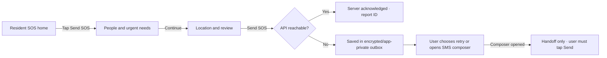

# Android UI Redesign Plan — Emergency SOS and Field Work

**Status:** Plan only; no UI implementation is included here.
**Scope:** Flutter Android resident SOS, responder and volunteer workspaces.
**Product boundary:** Aali is a demo decision-support prototype. Mock NID is only a format/uniqueness exercise, SMS is a user-initiated handoff, and the app does not promise rescue delivery.

## Goal

Make the Android app feel like a calm, dependable emergency tool first. A resident should be able to start and send an SOS without navigating a staff role picker or completing a profile. The status must make it obvious whether the API acknowledged the report, the report is queued locally, or an SMS composer was merely opened. Responders and Volunteers should each get a small field-oriented workspace after staff login.

## Current-state audit

- `main.dart` holds resident, onboarding, settings, blackout, outbox, SMS and D2C demonstration state in one very large StatefulWidget. Its long scroll combines a form and demo controls instead of focusing on the urgent task.
- Resident identity/onboarding and staff role selection compete in the entry flow. A personal profile should not be the step between opening the app and reporting danger.
- Staff workspaces exist in `staff_workspace.dart` and use real role-matched API login. This is a useful base, but the surfaces and navigation need a distinct responder/volunteer hierarchy and outdoor-first ergonomics.
- The app has API submission, compact packet, local pending payload and SMS composer handoff behavior. Keep their semantics and make state transitions much more visible.
- The app has a Material 3 light theme, but a theme alone does not create an emergency workflow. The screens still need a clearer action priority, short steps, useful recovery paths and role-specific information architecture.
- Bangla strings, route labels, API errors and status messages need an explicit UTF-8 rendering/content audit. No mojibake may reach a release build.
- Current seeded and mock flows must remain labeled. No official hotline, location certainty, SMS delivery or identity proof may be invented.

## Product experience

### Entry and role model

- App launch opens directly to the **Resident SOS home**. Do not require role choice, password, mock NID, phone number or precise location permission before the resident can start a report.
- Put **Staff sign-in** as a quieter, clearly labeled secondary route. After login, show only the server-confirmed role workspace. Keep switching back to Resident mode explicit and do not carry staff-only data into the resident screen.
- Make resident profile/mock NID registration optional and separate from immediate SOS access. Explain that it is synthetic format validation, never national identity verification.
- Language selector supports Bangla and English; use complete localized labels, not mixed-language debug text. Preserve the chosen language.

### Resident SOS home

Use one screen, suitable for one-handed use and poor connectivity:

```text
┌──────────────────────────────────┐
│ AALI AI           BN | EN   HELP │
│ Connection: Internet available   │
│ Location: Chitholia · change     │
│                                  │
│       NEED HELP NOW?              │
│   [ LARGE RED  SEND SOS  BUTTON ] │
│                                  │
│ Last report: received by server  │
│ Offline? Your next SOS is queued │
│                                  │
│ Staff sign-in (secondary)        │
└──────────────────────────────────┘
```

- Keep the main SOS action visually dominant with explicit `SOS` text, high-contrast white-on-red treatment, a large touch target and a non-color icon/label. Do not use a tiny floating action button, long-press, swipe-only gesture, countdown or confirmation puzzle.
- A deliberate first tap starts the report flow, not an immediate ambiguous one-tap dispatch. Label what happens before submission. If possible provide a readily accessible “send with current details” action on the confirmation/details screen.
- Display connection state in plain language: online, offline/unknown, sending, server acknowledged, saved on this device, retry needed. A green connection dot without text is insufficient.
- Show the selected village/location plainly and let the user change it. Request GPS only when the user chooses it, explain permission, and allow an SOS with unknown location or village selection.
- Put medical, trapped, child and older-person needs in the report-details step with large, explicit toggle rows and readable selected states.
- Keep emergency instructions brief and generic unless locally reviewed content exists. Do not invent hotline numbers, shelter guarantees or promises of rescue.

### Three-step report flow



- Step 1: choose people count with large plus/minus or a short numeric keypad; default to 1, visibly describe limits, and do not require flags.
- Step 2: select applicable urgent needs; all flags are optional. Use a clear selected/unselected shape, text and semantics.
- Step 3: show village/coordinate source, a short field summary, and one explicit **Send SOS** button. The user may send without GPS and without a mock NID/profile.
- API response changes state only after a real HTTP acknowledgment. Show stable short report ID, API received time and that responders must review it. Do not say that a rescue team has been notified unless an actual verified notification event exists.
- On a network error, persist the exact payload and client ID to the existing local outbox. Show `Saved on this device — not yet received by the server` with clear retry and SMS composer handoff actions.
- On SMS composer launch, show `SMS app opened. Review and tap Send there.` Do not change the state to delivered or server-acknowledged. If the user returns without sending, preserve the pending status.
- Retry uses the same `clientReportId` for idempotency. Clear the pending item only after API acknowledgment, not after opening the composer.
- Prevent accidental double taps while sending, but retain an accessible retry path after timeout. State transitions are announced to TalkBack and are not communicated by color alone.

### Responder workspace

- Landing view prioritizes counts and an assigned/review-needed incident list, newest and highest rule priority first. Never imply that a recommendation is a dispatch.
- Compact top bar shows responder role, API/offline state, last refresh and sign-out. Use two primary destinations: **SOS/Incidents** and **Area/Assets** (only if the data is actually available to this role).
- SOS cards show stable short ID, age, known village/location quality, people count, urgency flags, review state and source/provenance. Unknown coordinates remain visible and must not be mapped to a fabricated point.
- Incident detail exposes report history, duplicate candidates and their evidence, rule confidence evidence, suitable assets and explicit accept/reject review actions. Acknowledge boat suggestions without suggesting that a boat departed.
- Provide a deliberate list-first fallback when maps/tiles/API are unavailable. Distinguish cached data and its last sync time from current server data.

### Volunteer workspace

- Landing view has one clear primary action: **Submit a field observation**. Keep the current village/area, reading value/unit, observed time and short note in a short, large-control form.
- Offer a second compact destination for recent submissions and a way to correct/retry only where an API endpoint supports it.
- Label every entry `Volunteer-submitted observation`; never render it as an official gauge reading. Clearly state whether it is saved locally or acknowledged by the API.
- Keep the volunteer workflow distinct from SOS intake and rescue decisions.

## Visual and interaction system

- Build on Flutter Material 3 components and the current project dependency set. Establish shared type styles, spacing, surface/border roles, focus/pressed/disabled/error states and a restrained semantic palette.
- Use a clean light surface for outdoor daylight readability; reserve strong emergency red for SOS actions and danger states, amber for caution, teal/blue for information and connection, and neutral surfaces for routine content. Test the actual text/background pairs for contrast; never rely on color alone.
- Use large labels and plain-language verbs; avoid dense paragraphs and small helper text in the urgent path. Bangla and English layouts must survive 200% text scaling, long Bangla words and narrow widths without clipping.
- Ensure all interactive controls have at least Android's recommended 48×48 dp touch area, comfortable spacing, visible focus/pressed states and TalkBack labels/order. Respect SafeArea/cutouts and do not lock orientation.
- Keep settings, API address, blackout simulation, simulated D2C and demo-only tools out of the main emergency surface. Put them behind a clearly labeled **Demo and connection settings** screen, with each simulation visibly labeled and reversible.
- Replace mojibake and emoji used as the only icon/status language. Use Material icons with text labels and meaningful semantic descriptions.

## Implementation increments

1. **Flow and content audit:** map all current state transitions, local-storage behavior and API routes. Verify exactly what response counts as acknowledgment; inventory all Bangla/English strings and remove mojibake in the design scope.
2. **Resident SOS entry and home:** make Resident SOS the app start route; move Staff sign-in to a secondary route; make profile/mock NID optional; deliver the connection/location strip and one dominant SOS action.
3. **SOS capture and delivery states:** split the form into short people/needs and location/review steps; retain packet schema and API; harden persistent outbox, idempotent retry and truthful SMS composer handoff.
4. **Responder field workspace:** simplify routes, list and report detail; improve role-specific triage and safe recommendation review; provide cached/list fallback states.
5. **Volunteer field workspace:** streamline field reading and submission acknowledgment; ensure submitted readings remain distinct from official gauge sources.
6. **Accessibility and device pass:** check small Android phone, larger phone/tablet, TalkBack, increased text size, daylight contrast, poor/absent internet, rotation and physical-device API configuration.

## Acceptance criteria

- Cold launch opens Resident SOS; no role picker, login, profile, mock NID or GPS permission blocks a resident report.
- A resident can complete the intended three-step SOS flow with one hand at 320×720 logical pixels and at 200% text scale without clipped controls or horizontal overflow.
- People count and each urgent flag are reviewable before send. Location can be unknown, manually selected, or supplied after explicit permission.
- Online submission shows `API acknowledged` only on HTTP success; offline submission survives process restart as a local pending report and keeps the same idempotency ID on retry.
- SMS composer handoff is initiated by the user and is labeled not delivered until evidence exists; abandoning the composer leaves the report pending.
- The SOS entry and result work without a resident account or mock NID. Mock NID remains clearly labeled and is not called verification.
- Responder and Volunteer logins continue to be validated against server role; each workspace shows only its role's tasks, truthful connectivity/freshness and API-backed status.
- Responder actions remain review/acknowledgment only and cannot auto-dispatch. Volunteer observations remain visibly non-official.
- Critical controls meet 48×48 dp recommended targets; contrast, TalkBack names/order, focus and text scaling are manually verified on Android.
- Bangla and English strings render correctly with no mojibake. Loading, empty, network error, queued/offline, server acknowledgment and retry states have explicit text.
- `flutter analyze`, relevant Flutter tests and Android debug build pass; device review includes offline and API-forwarded online SOS attempts with observed server acknowledgment.

## Out of scope and constraints

- No new backend role, SOS schema, packet fields, SMS permission or external service is assumed by this visual plan. If making guest SOS requires changes to intake rate-limits or storage, define and test that as its own API/security change.
- Do not add phone-call/SMS auto-send behavior. Android composer handoff remains user initiated.
- Do not claim that local queue guarantees message delivery, that mock NID verifies identity or that an SOS is guaranteed to be seen by rescue services.
- Keep map tiles and asset availability optional in field workspaces; no invented incident coordinate or real dispatch workflow.
- The installed Figma generation/design-system skills can support a future Figma pass after a Figma MCP connection is available. This plan does not depend on it.

## Research references

- [Flutter Material design](https://docs.flutter.dev/ui/design/material) — Flutter's Material 3 implementation and theming.
- [Flutter adaptive and responsive design](https://docs.flutter.dev/ui/adaptive-responsive) — adapt layouts to available space and input modality.
- [Flutter adaptive design best practices](https://docs.flutter.dev/ui/adaptive-responsive/best-practices) — touch-first layouts, smaller components and preserving state.
- [Android accessibility guidance](https://developer.android.com/guide/topics/ui/accessibility/views/apps-views) — recommended minimum 48×48 dp target area and accessible controls.
- [WCAG 2.2 text contrast guidance](https://www.w3.org/WAI/WCAG22/Understanding/contrast-minimum.html) — text contrast thresholds and rationale.
